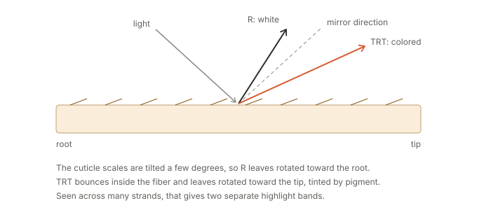
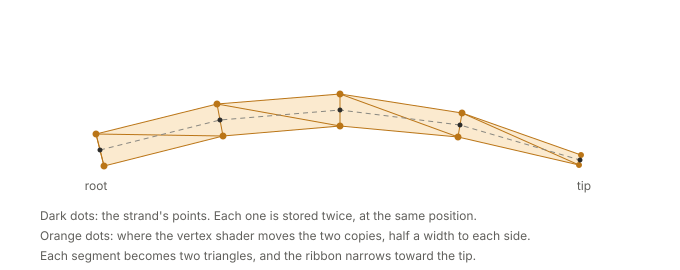

# Hair rendering: a walkthrough of the Hair Rendering Lab

Each step says what to look at in the lab.

## The one idea

Hair is thousands of thin, shiny, translucent cylinders. That breaks three habits from rendering surfaces:

1. **There is no surface normal.** A fiber only has a direction, its **tangent**.
2. **Light goes through.** Each fiber is a tiny glass-like rod with pigment inside.
3. **It shadows itself like a volume.** Light fades gradually as it passes more strands, instead of being simply blocked or not.

Every part of the lab answers one of those three.

## Step 1: Geometry (thumbnails 1 and 2)

**Growing the strands.** Simulating 10,000 strands one by one would give noise, not a hairstyle. The lab does what grooming tools do:

1. Grow a few hundred **guide strands** from the scalp. Each starts along a combing direction, bends under gravity segment by segment, and is pushed out of the head and shoulders when it collides.
2. Grow about 30 **render strands** around each guide, as offsets from it:
   - **Clumping** shrinks the offset toward the tip, so strands gather into locks.
   - **Curl** winds the offset around the guide as a helix.
   - **Frizz** adds a random walk per strand.

**Drawing a strand.** A strand is a polyline with no width, so each point becomes two vertices that the vertex shader pushes apart sideways, perpendicular to both the strand and the view direction. The ribbon always faces the camera:

```glsl
vec3 toCam = normalize(eye - pos);
vec3 side  = normalize(cross(tangent, toCam));   // sideways, as seen from the camera
pos += side * (±0.5) * width;                    // one vertex each way
```

Thumbnail 1 shows the tangents as colors, and thumbnail 2 gives each strand a random color so you can see the clumps.

## Step 2: Strands thinner than a pixel

A real hair is about 0.08 mm wide, far less than a pixel at any normal distance. A sub-pixel ribbon either disappears between pixel centers or flickers. The lab's fix has two parts:

```glsl
float px = pixelSizeAtThisDistance;
float w  = max(width, px);          // never thinner than one pixel
float coverage = width / w;         // ...but remember how much of the pixel it really fills
```

The coverage becomes **alpha**, and **alpha-to-coverage** turns that alpha into a number of MSAA samples. Thin hair fades instead of aliasing, and no sorting is needed.

*Try it:* zoom far out and toggle **Thin-strand fade**. Without it, every strand stays a full opaque pixel wide and the hair looks like wire.

## Step 3: Why surface shading fails

Pick **Surface shading**. It treats the hair as a solid shell with a normal and gives a round highlight blob, the "plastic helmet." Real hair shows a highlight **band** that runs across the strands, like the ring of light on a head of straight hair.

## Step 4: Kajiya–Kay (1989): shade by tangent

A thin cylinder doesn't reflect light in one direction. It reflects into a **cone** around its own axis. So the shading depends only on angles to the tangent **T**:

```glsl
float sinTL = sqrt(1.0 - dot(T, L) * dot(T, L));
float sinTV = sqrt(1.0 - dot(T, V) * dot(T, V));
vec3 diffuse  = color * sinTL;                              // brightest when light is perpendicular to the strand
float specular = pow(sinTL * sinTV - dot(T, L) * dot(T, V), shininess);   // V on the reflection cone
```

That turns the blob into a band, for almost no cost, and it's still used on hair cards in many games. What it lacks: the highlight is a single white band, the hair doesn't glow when back-lit, and it isn't based on how fibers actually scatter light.

## Step 5: Marschner (2003): three light paths

Marschner measured real hair and found that three paths carry most of the light (the small diagram in the lab's panel shows them through a fiber's cross-section):

- **R:** reflects off the outer surface. White, like the light.
- **TT:** refracts in and out the far side. Strongest when the light is **behind** the hair.
- **TRT:** refracts in, reflects off the inside back wall, and refracts out. It travels through the pigment twice, so it takes the **hair's color**.



**Why there are two highlight bands.** The fiber's surface is covered in cuticle scales tilted a few degrees toward the root. That tilt rotates R toward the **root** and TRT toward the **tip**. So instead of one band you see a white one and, slightly offset, a colored one.

Each lobe is a product of two terms:

```glsl
// along the strand: a Gaussian around the (shifted) cone
M = gaussian(roughness_p, sin(thetaL) + sin(thetaV) - shift_p);
// around the strand: how much light takes this path at this angle phi between L and V
N_R   = 0.25 * cos(phi / 2);
N_TT  = exp(-3.65 * cos(phi) - 3.98);        // peaks when L and V are on opposite sides
N_TRT = exp(17.0 * cos(phi) - 16.78);        // peaks when they're on the same side
lobe = M * N * fresnel * absorption(color);  // absorption only for TT and TRT
```

The lab uses Karis's fitted version from Unreal (2016), with shifts of −2α, +α and +4α for R, TT and TRT, where α is the **Cuticle tilt** slider.

*Try it:*
- Press **Highlight close-up** and drag **Cuticle tilt**. At 0 the two bands overlap. Raise it and they slide apart. Thumbnails 4 and 6 show them separately.
- Press **Back-lit shot** and toggle **TT**. The glowing rim is light coming through the fibers. It's strong on blond hair and nearly absent on black, because pigment absorbs it.

## Step 6: Multiple scattering

The three lobes describe light that hits **one** fiber. In light-colored hair, most of what you see is light that bounced between **many** fibers. That's why blond hair is bright and soft-looking, not just "brown with more gain."

Simulating it properly is expensive (dual scattering, or path tracing), so the lab uses Karis's cheap stand-in: a soft, wrapped diffuse term tinted by the hair color.

```glsl
vec3 fakeN = normalize(V - T * dot(T, V));                  // a made-up normal facing the camera
float wrap = (dot(fakeN, L) + 1.0) / 4.0;
vec3 scatter = sqrt(color) * mix(wrap, 1.0 - abs(dot(T, L)), 0.33) * amount / PI;
```

*Try it:* pick **Blond** and drag **Multi-scatter** to 0. The hair goes dark and dull.

## Step 7: Self-shadowing (thumbnail 3)

Hair without self-shadowing looks flat and seems to glow from inside. A normal shadow map says "lit or not," but one strand doesn't fully block light. It removes a little, and the next strand removes a little more.

The lab's **deep shadow approximation** uses an ordinary shadow map differently. The map stores where light *enters* the hair. Each strand compares its own depth against that to get how far inside the hair it sits, and fades the light by that distance:

```glsl
float depthInside = max(myDepthFromLight - shadowMapDepth, 0.0) * range;   // world units
float lightReach  = exp(-depthInside * density);                           // averaged over 9 taps
```

*Try it:* switch between **None**, **Hard** and **Deep**. Hard shadows are noisy, because neighboring strands flip between fully lit and fully dark. The deep version gives the soft falloff toward the roots and the underside that makes hair look like a volume. The **Density** slider sets how fast light fades.

Film renderers store a full transmittance curve per texel (deep shadow maps), and games have used layered versions (deep opacity maps). The single-depth version here is what real-time engines commonly fall back to.

## Step 8: Why hair is forward-rendered

The other labs use a G-buffer. Hair usually doesn't, for three reasons:

- A G-buffer stores **one surface per pixel**, and a pixel of hair contains many semi-transparent strands.
- Its shading model needs a **tangent**, not a normal, and has different parameters from everything else.
- It depends on **MSAA and alpha coverage** to look right.

So the lab shades hair in the fragment shader as it's drawn, straight to the screen.

## Cost, and what games do

The lab draws 10,000 strands; a real head has around 100,000. Two approaches exist in games:

- **Hair cards:** a few hundred textured strips, each painted with many strands plus an alpha mask, shaded with Kajiya–Kay or a Marschner fit. Cheap, and still the most common.
- **Strand-based hair:** real strands, as in this lab, with level-of-detail that thins the count and widens the strands with distance. This is what TressFX, HairWorks and Unreal's Groom system do, and it's becoming standard for main characters.

## The limits

- **Single scattering plus a fake.** The multiple-scattering term is a rough stand-in, so very light hair is less accurate than dark hair.
- **One depth for shadows.** The deep approximation assumes uniform density between the light and the strand.
- **No sorting.** Alpha-to-coverage gives only a few alpha levels (4× MSAA here), so soft edges are slightly grainy.
- **Static.** There's no simulation; the strands are generated once.

## The whole pipeline, in one breath

**Grow guides, then strands around them** → **shadow map** from the light → **draw each strand as a camera-facing ribbon**, at least one pixel wide, with alpha for the rest → **shade by tangent**: R + TT + TRT + fake multiple scattering → **fade the light** by depth inside the hair → **alpha-to-coverage** resolves the thin strands.

---

# Notes: strand geometry and the surface-shading normal

## How each strand is rendered

Each strand is a **ribbon**: a thin strip of triangles that always turns to face the camera.



### The geometry of one strand

- **15 points** along the strand (14 segments), generated on the CPU.
- **2 vertices per point**, so 30 vertices. Both copies store the *same* position; only a `side` value (−1 or +1) tells them apart.
- **2 triangles per segment**, so 28 triangles.

Each vertex is 10 floats (40 bytes):

| Attribute | Contents |
|---|---|
| position (3) | the point on the strand's center line |
| tangent (3) | direction of the strand at that point, root → tip |
| params (4) | `t` along the strand (0 at the root, 1 at the tip), `side` (±1), a random number per strand, a random number per guide |

All strands live in **one vertex buffer and one index buffer**, drawn with a single `drawElements` call. At the default 10,000 strands that's 300,000 vertices and 280,000 triangles.

### The vertex shader makes the ribbon

The buffer holds no width at all. The vertex shader creates it every frame:

```glsl
vec3 toCam = normalize(eye - aPos);
vec3 side  = normalize(cross(aTan, toCam));          // perpendicular to the strand AND to the view
float w    = width * mix(1.0, 0.3, smoothstep(0.55, 1.0, t));   // taper toward the tip
float px   = pixelSize * distance(eye, aPos);        // how big one pixel is out here
float wf   = max(w, px);                             // never thinner than a pixel
vCoverage  = w / wf;                                 // becomes alpha
vec3 p     = aPos + side * aSide * 0.5 * wf;         // push this copy to its side
```

Because `side` is rebuilt from the camera position, the ribbon faces you from every angle. You never see it edge-on, which a fixed flat strip would do.

### Why a flat ribbon can pass for a cylinder

The shading never uses the ribbon's own normal. Kajiya–Kay and Marschner depend only on the **tangent**, the light direction and the view direction. So a flat strip a few pixels wide shades exactly like a thin cylinder would, at 2 triangles per segment. A real tube would need 8 or more.

### The rest of the draw

- **Depth test and depth write on**, face culling off.
- **Alpha-to-coverage on,** so the coverage value fades strands thinner than a pixel.
- **The shadow pass reuses the same buffers,** with the ribbons turned to face the light and widened to at least 1.5 shadow-map texels.

### Other ways to do it

- **Line primitives** (`GL_LINES`): the simplest option, but lines are 1 pixel wide on most platforms, with no taper and no control. It was common in early strand renderers.
- **Expanding from a point buffer:** engines such as TressFX store only the strand points and build the two vertices in the vertex shader from the vertex index, so nothing is stored twice. It's the same ribbon with half the memory.
- **Hair cards:** a wide textured strip represents dozens of strands at once. The geometry is far cheaper, but the strands are painted in a texture, not real.
- **Software rasterization in compute shaders:** recent strand systems draw sub-pixel strands this way, because GPUs rasterize very thin triangles inefficiently.

## In surface shading, how is the normal calculated?

It isn't calculated per strand. A strand has no normal, so that mode invents one from the **position** of each pixel, as if the hair were a smooth shell around the head.

### What the lab does

One line in the fragment shader:

```glsl
vec3 N = normalize(vec3(vW.x, max(vW.y, 0.0), vW.z));   // vW = world position of this pixel of hair
```

The head's center is at the origin, so this is two cases:

- **Above the head's center (y > 0):** the normal points from the center of the head out through the pixel. That's the normal of a sphere, which fits the hair lying on the skull.
- **Below it (y ≤ 0):** the y part is clamped to zero, so the normal points straight out horizontally from the vertical axis. That's the normal of a cylinder, which fits hair hanging down like a curtain.

Together that's a dome on top of a tube, roughly the shape of a long hairstyle. The strand's own direction, curl and frizz have no effect, which is why every strand in a region gets nearly the same normal and the result looks like a molded helmet.

After that it's ordinary surface lighting: `max(dot(N, L), 0)` for diffuse and Blinn-Phong for the highlight.

### Why it's that crude

That mode is the "what goes wrong" baseline. Any smooth normal field gives the same failure: a round highlight blob that ignores the strands.

### How it's done when surface normals are actually used

Games with hair **cards** often do light them partly with surface-style normals, and get them in more careful ways:

- **Transferred from a proxy shape.** Artists wrap a smooth shell around the hairstyle, and each card vertex copies the normal of the nearest point on it. Same idea as the one-liner, with a sculpted shape in place of a dome and tube.
- **Bent card normals.** A card's flat normal is tilted toward that shell normal, so neighboring cards shade smoothly together and don't look like separate planes.
- **Used for diffuse only.** The smooth normal drives soft wrapped diffuse lighting, while the highlight still uses the **tangent** (Kajiya–Kay or Marschner). The highlight is the part where a normal fails most visibly.

Karis's multiple-scattering term in the lab's Marschner mode does something similar. It builds a made-up normal per pixel, `normalize(V - T * dot(T, V))`, which is the direction perpendicular to the strand that faces the camera most, and uses it only for the soft diffuse part.
