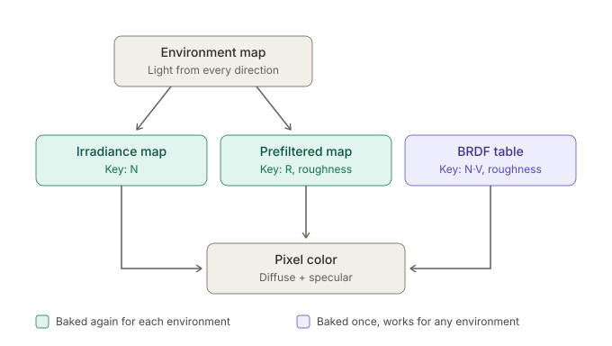

# Image-based lighting: a walkthrough of the lab

Each step says what to look at in the lab. The thumbnails under the scene are numbered 1 to 7.



## The one idea

With a point light, each pixel evaluates the lighting formula once. With an environment map, light arrives from every direction, so the pixel would have to add up the formula over the whole hemisphere. Doing that sum per pixel is far too slow.

The fix is to do the sums ahead of time and store the results in textures. At run time a pixel only reads them.

```
color = diffuse × irradiance(N)
      + prefiltered(R, roughness) × (F0 × A + B)
```

## Step 0: The environment (stage 1)

The environment is a cube map that stores the light arriving from each direction. It must be HDR. In the lab's sunny sky, the sky is around 1 and the sun disc is 320. If the texture clamped at 1, the sun would light the scene no more than a patch of sky does.

The lab draws its environments with a shader, so it needs no image files.

## Step 1: Diffuse light (stage 2)

A matte surface collects light from the whole hemisphere around its normal, weighted by the cosine of the angle. The result depends only on the normal N, so it fits in a cube map indexed by N.

The bake loops over the environment for each output direction:

```glsl
float w = max(dot(n, d), 0.0) / pow(1.0 + dot(p, p), 1.5);   // cosine x solid angle of the texel
sum += textureLod(uEnv, d, uSrcLod).rgb * w;  wsum += w;
```

The result is very blurry, so it can be tiny. The lab reads a 16 × 16 mip of the environment and writes 32 × 32 texels per face. The section at the end of this page explains the bake in detail.

### Spherical harmonics

That blurry function is so smooth that 9 colors describe it almost exactly. The lab projects the environment onto 9 basis functions once, on the CPU. The shader then rebuilds the irradiance with a short polynomial in N, with no texture read.

*Try it:* switch the **Diffuse** menu between the cube map and spherical harmonics and watch the plastic row.

## Step 2: Specular light

Specular is harder. The reflected light depends on N, the view direction V, the roughness and the base reflectance F0. That is too many inputs for one texture.

The split-sum method (Karis, 2013) approximates the one sum as a product of two smaller ones:

- the average light inside the reflection lobe, and
- how much light the surface reflects in total.

### The prefiltered map (stage 3)

A rough surface reflects a cone of directions, and the cone is wider with more roughness. The bake blurs the environment with that cone and stores one roughness per mip level. The lab has 6 levels, for roughness 0, 0.2, and so on up to 1.

The cone's shape also depends on the view angle, which is not known at bake time. So the bake makes a big assumption: the view direction, the normal and the reflection direction are all the same.

```glsl
vec3 N = dir, V = N;
vec3 H = sampleGGX(hammersley(i, uSamples), N, a);   // likely half vectors come up more often
vec3 L = 2.0 * dot(V, H) * H - V;
sum += textureLod(uEnv, L, lod).rgb * NoL;  wsum += NoL;
```

**The speckle fix.** With few samples, some land on the sun and some miss, so the result has bright dots. The fix is to read a blurrier mip of the environment for samples that stand for a large solid angle.

*Try it:* with **Sunny sky**, turn off **Read a blurrier mip** and open stage 3. Then raise **Samples per texel**: the dots fade slowly, while the checkbox removes them at once.

### The BRDF table (stage 4)

The second sum has no light in it. Fresnel is `F0 + (1 − F0)(1 − V·H)^5`, so F0 can be pulled out, and the sum becomes `F0 × A + B`. A and B depend only on the view angle N·V and the roughness, so they fit in a small 2D texture.

Because the table contains no light, it is baked once and works for every environment.

### At run time

```glsl
vec3 R     = reflect(-V, N);
vec3 light = textureLod(uPre, R, roughness * maxMip).rgb;   // blurred light
vec2 ab    = texture(uLut, vec2(NoV, roughness)).rg;        // how much is reflected
vec3 spec  = light * (F0 * ab.x + ab.y);
```

That is two texture reads, in place of hundreds of samples.

*Try it:* step the **Specular** menu from 1 to 3 and watch the rough spheres on the right. A mirror read is wrong for them, the prefiltered map fixes the blur, and the table adds the bright edges.

## Step 3: Metal and plastic

One pair of lines covers both rows of the grid:

```glsl
vec3 F0   = mix(vec3(0.04), albedo, metal);   // plastic reflects 4%, metal reflects its color
vec3 base = albedo * (1.0 - metal);           // metal has no diffuse light
```

Diffuse light is then scaled by what specular did not take: `base * (1 − (F0 × A + B))`.

## Where the approximation is off

Set **Specular** to **4. Reference**. Every pixel then draws many samples and applies the full formula.

- Under uniform light (the white furnace), split sum and the reference matched in a test run.
- Under real lighting they matched at the center of a sphere and differed on rough spheres near their edges. That is where the view direction is far from the normal, so the bake's assumption is most wrong.

## Energy compensation

The table only counts light that bounces once off the microscopic surface. On a rough surface, some light bounces several times, and that light is missing.

The white furnace shows it. The light is the same from everywhere, so a white object that reflects everything should be invisible. Rough metal spheres come out darker than the background.

*Try it:* pick **White furnace**, then turn on **Energy compensation**. It estimates the missing light from A and B and adds it back, and the spheres vanish.

## What it costs

| Item | Size in the lab |
|---|---|
| Environment, 256 per face with mips | 4.0 MB |
| Prefiltered map, 128 per face, 6 levels | 1.0 MB |
| Irradiance cube, 32 per face | 48 KB |
| Spherical harmonics | 108 bytes |
| BRDF table, 128 × 128 | 128 KB |

Per pixel, split sum with the irradiance cube needs 3 texture reads. The reference at 64 samples needs 65.

The lab was tested only in headless Chrome with software rendering, so the bake times in its Measured list will be different on a real GPU.

## What real engines add

- **Captured light:** HDR photographs, or the game's own sky and scene rendered into a cube.
- **Local probes:** many small environment maps placed around a level, blended by position, so that a room reflects its own walls.
- **Screen-space reflections on top:** nearby objects come from the screen, and the environment fills in the rest.
- **Occlusion:** a surface in a crevice should not reflect the open sky, so the result is darkened by an occlusion term.

## The whole pipeline in short

**Once per environment:** bake the irradiance map (or 9 colors) and the prefiltered map.

**Once ever:** bake the BRDF table.

**Per pixel:** read irradiance with N, read the prefiltered map with R and roughness, read the table with N·V and roughness, and add diffuse and specular.

---

# How the irradiance map is calculated

Each texel of the irradiance map answers one question: if a matte surface faced this direction, how much light would it receive in total? To answer it, you add up the entire environment, with each incoming direction weighted by how directly it hits the surface.

## The formula

For a surface normal n:

```
E(n) = sum over all directions d of   L(d) × max(n · d, 0) × (solid angle of d)
```

- `L(d)` is the environment's color in direction d.
- `max(n · d, 0)` is the cosine weight. Light from straight ahead counts fully, light from the side counts little, and light from behind counts as zero.
- The solid angle is how much of the sphere that sample covers.

The map stores `E(n) / π`, because the matte (Lambert) formula is `albedo / π × E`. The shader can then just multiply the texel by the albedo.

## How the lab does the sum

The output is a small cube map. For every texel of it, the shader takes that texel's direction as n and loops over all texels of the environment:

```glsl
for (int f = 0; f < 6; f++) for (int y = 0; y < 16; y++) for (int x = 0; x < 16; x++) {
  vec2 p = (vec2(x, y) + 0.5) / 8.0 - 1.0;          // position on the face, -1 to 1
  vec3 d = normalize(faceDir(f, p));                // direction of this environment texel
  float w = max(dot(n, d), 0.0) / pow(1.0 + dot(p, p), 1.5);
  sum += textureLod(uEnv, d, uSrcLod).rgb * w;  wsum += w;
}
o = vec4(sum / wsum, 1.0);
```

Three details in that code matter:

- **The solid angle term.** Texels of a cube map do not cover equal parts of the sphere. A texel in the middle of a face covers more than one near a corner, which is farther from the center and seen at a slant. The factor `1 / (1 + u² + v²)^1.5` is that correction. Without it, the corners of the cube would count too much.
- **Dividing by the sum of the weights.** The exact sum of all cosine weights over a hemisphere is π, so dividing by `wsum` is the division by π. Using the measured sum has one advantage: a uniform environment of value 1 gives exactly 1, with no rounding error from the grid.
- **Reading a small mip.** The loop does not read the full 256 × 256 environment. It reads the 16 × 16 mip level, which is 1,536 texels in total. The cosine weight is so wide that averaging the environment first barely changes the answer. The mip chain is built by averaging, so a small bright sun keeps its total energy.

## Why the result is so blurry

Every output texel averages half of the whole sphere, and two nearby normals share almost all of that half. So neighboring texels are nearly identical, and the map has no fine detail. That is why 32 × 32 per face is enough, and why 9 spherical-harmonic colors can replace it.

## The cost

The lab's bake is 32 × 32 × 6 output texels, each summing 1,536 samples, which is about 9.4 million texture reads. It runs once per environment. In a software-rendered test it took 266 ms, and a real GPU should be much faster.

## The other common way

Many engines use random sampling instead: for each output texel, pick a few hundred random directions in the hemisphere and average them. It is the same sum, estimated with fewer samples. With a small, very bright sun it gives noisy results unless you also read from a blurred mip, which is the same trick the lab uses for the prefiltered map.
