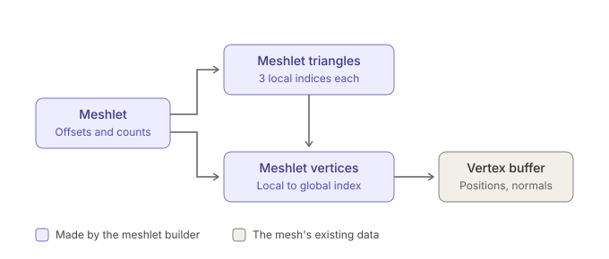

# Mesh shaders: a tutorial

Try each step in the lab as you read.



**A note on the lab.** Browsers cannot run mesh shaders: WebGL 2 has none, and for WebGPU they were still an open feature request when this was written (November 2026). The lab runs the same pipeline by other means (see "How the lab does this without mesh shaders"). The Vulkan GLSL in its code box is reference code. It was written for reading and has not been compiled.

## The idea

In the classic pipeline, the GPU must run the vertex shader on every vertex before it can discard anything. A mesh shader pipeline works on small groups of triangles instead. It can throw away a whole group with one cheap test, and only then spend vertex work on the groups that remain.

There are three steps: cut the mesh into meshlets ahead of time, test each meshlet in a task shader, and output the survivors in a mesh shader.

```
meshlets (built offline) → task shader → mesh shader → rasterizer → fragment shader
```

## Step 1: Build meshlets (offline)

A meshlet is a small piece of the mesh with a hard limit on its size. A common choice is 64 vertices and about 124 triangles.

The index buffer is replaced by the two lists in the drawing:

- **Meshlet vertices:** for each meshlet, the vertex buffer indices it uses.
- **Meshlet triangles:** three positions in that list per triangle. Because a meshlet has few vertices, each one fits in a single byte.

The vertex buffer itself does not change.

```c
struct Meshlet {
  uint vertexOffset;     // where its vertex list starts in meshletVertices[]
  uint triangleOffset;   // where its triangles start in meshletTriangles[]
  uint vertexCount;      // at most 64
  uint triangleCount;    // at most 124
};
struct MeshletBounds {
  vec3 center; float radius;        // bounding sphere, for frustum culling
  vec3 coneAxis; float coneCutoff;  // normal cone, for backface culling
};
```

### How triangles are grouped

The lab has two builders:

- **Index order:** walk the index buffer and start a new meshlet when a limit is reached. This is fast, but the shape of each meshlet depends on the index order. On the torus knot it produces rings around the tube.
- **Greedy:** start from one triangle and repeatedly add the best neighbor. In the lab, "best" means it reuses vertices already in the meshlet, lies near the meshlet's center, and faces a similar direction.

The function is `buildMeshlets` in the lab. Its greedy version is simple and leaves some meshlets small (on average 55.5 of 64 vertices are used). Production tools such as meshoptimizer pack them better.

### Bounds

The builder also stores two things per meshlet, for the culling tests:

- **Bounding sphere:** a center and a radius.
- **Normal cone:** the average triangle normal (the axis) and how far the worst triangle strays from it.

## Step 2: The task shader

The task shader runs before any vertex work. One run looks at a batch of meshlets and decides which ones to draw.

**Frustum test.** If the sphere lies completely behind any of the six planes of the view volume, the meshlet cannot be visible:

```glsl
if (dot(plane.xyz, center) + plane.w < -radius) cull;
```

**Cone test.** If every triangle in the meshlet faces away from the camera, the rasterizer would discard all of them anyway, so the meshlet can be skipped:

```glsl
vec3 d = center - eye;
if (dot(d, axis) >= cutoff * length(d) + radius) cull;
```

Here `cutoff` is the sine of the cone's half-angle. The reasoning: a triangle faces away when the view direction and its normal point the same way. If all normals lie within angle α of the axis, they all face away once the view direction is within 90° − α of the axis. The `radius` term covers the fact that the triangles are spread around the center.

When the normals spread too widely, no cone is stored and the test is skipped. This is why the ring-shaped meshlets from the index-order builder can never be cone-culled.

**Level of detail.** The task shader can also choose which version of the mesh to use. The lab makes one choice per object, from its size on screen, before testing any meshlet.

**Output.** The shader writes the surviving meshlet indices into a payload and calls `EmitMeshTasksEXT(count, 1, 1)`. That launches one mesh shader run per survivor.

In the lab this step is `runTasks()` in JavaScript.

## Step 3: The mesh shader

One mesh shader run outputs one whole meshlet:

1. Declare the output size with `SetMeshOutputsEXT(vertexCount, triangleCount)`.
2. Loop over the meshlet's vertices. Load each one through the meshlet vertices list, transform it, and write it. Each vertex is processed once.
3. Loop over the triangles and write three local indices for each.

It can also write values per triangle, marked `perprimitiveEXT`. The Triangles and Meshlets stages in the lab are colored this way. In the classic pipeline you would have to duplicate vertices to get a flat value per triangle.

## How the lab does this without mesh shaders

- **Buffers:** the meshlet records, both lists, the bounds and the vertex data are stored in textures.
- **Task shader:** JavaScript tests every meshlet each frame and uploads the list of survivors.
- **Mesh shader:** an instanced draw with one instance per surviving meshlet. The vertex shader uses `gl_VertexID` to find the triangle and corner, then follows the chain in the drawing: meshlet record, local index, vertex buffer index, position.

The cost difference is real. In a test run of the field scene, a mesh shader would have transformed about 39,000 vertices, and the emulation ran about 202,000 vertex shader invocations.

## What the numbers show

These are from the field scene's default view in one test run. Your numbers will differ with window size and camera position.

| Stage | Meshlets | Triangles |
|---|---|---|
| Full meshes | n/a | 422,912 |
| After level of detail | 2,632 | 204,800 |
| Frustum-culled | 1,889 (72%) | n/a |
| Cone-culled | 83 (3%) | n/a |
| Drawn | 660 (25%) | 54,216 |

Cone culling does little in the field, because distant objects use coarse meshes whose few meshlets have wide cones. On the single torus knot it removed 16% of the meshlets, and on the single rock 22%.

The lab was tested only in headless Chrome with software rendering, so there are no frame rates for a real GPU here.

## What real engines add

- **Occlusion culling:** the task shader also tests each sphere against a depth pyramid from the previous frame, so meshlets hidden behind other objects are skipped.
- **Per-triangle culling:** the mesh shader can drop single triangles that are back-facing or smaller than a pixel.
- **Meshlet-level detail:** systems in the style of Nanite choose the level of detail per group of meshlets, not per object.

Mesh shaders are available in DirectX 12, in Vulkan through an extension, and in Metal 3. They need fairly recent GPUs.

## Things to try in the lab

1. Watch **Task shader result**: the yellow volume is what the main camera sees. Meshlets outside it turn dark, and meshlets on the far side of each object turn red.
2. Switch to **Final image**. Nothing looks missing, although most meshlets are skipped.
3. Turn **Cone culling** off and on and read **Drawn** in the Measured list.
4. Pick **Torus knot**, open **Bounds and cones**, and switch the builder to **Index order**. No cone is usable.
5. Drag **Max triangles** down to 16, then up to 200.
6. Set **Max vertices** to 16 with 124 triangles and check **Average meshlet fill**.
7. Open **Level of detail** and move **Full detail above**.

---

# When are the level-of-detail versions made and stored?

They are made ahead of time, when the asset is built, and saved with it. Nothing is simplified while the game runs. At run time the engine only chooses which stored version to draw.

## When they are created

- **By an artist:** someone models the lower versions by hand in a tool like Blender or Maya. This gives the best quality, and it is common for characters and other important objects.
- **Automatically at import:** the engine or a build tool runs a mesh simplification algorithm that removes edges until a target triangle count is reached. Unreal, Unity, Simplygon and meshoptimizer all offer this.
- **In a mesh shader pipeline:** the meshlets and their bounds are built for every version in the same offline step.

The lab follows the same order, except that "build time" is page load. It generates each object at three resolutions, puts all of them into one shared vertex buffer, and runs the meshlet builder on each. In `runTasks()`, the only per-frame work is picking a version per object from its size on screen.

## Why not simplify at run time?

Good simplification is slow. It has to measure how much each removal changes the shape, and also protect UV seams and silhouettes. That takes far longer than a frame, so it is done once and stored.

## When it is worth storing them

It pays off when an object has many triangles and is seen from very different distances. Far away, a detailed mesh produces triangles smaller than a pixel. Those cost vertex work, add nothing visible, and rasterize inefficiently.

It is not worth it when:

- the object is already low-poly, or
- it is always seen from about the same distance, such as a first-person weapon.

## What it costs

- **Memory:** less than you might expect, because each version is much smaller than the one before. In the lab, the rock's two extra versions add about 31% to its triangle count and the knot's add about 41%. Engines often load the coarse versions first and stream the detailed one in when needed.
- **Popping:** the switch between versions can be visible. Engines hide it with a cross-fade or dither, or by switching only when the difference is under a pixel.

Systems in the style of Nanite still follow the same rule. They build a whole hierarchy of simplified meshlet groups offline, and at run time they only select from it, per group instead of per object.
