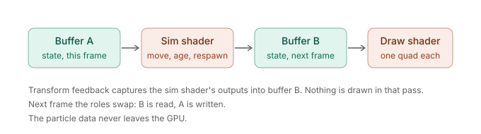

# Particle systems: a walkthrough of the Particle Systems Lab

Each step says what to look at in the lab.

## The one idea

A particle is four things: a **position**, a **velocity**, an **age** and a **lifetime**. In the lab that's 8 floats. Every frame does the same three jobs:

1. **Spawn:** give dead particles a new starting position and velocity.
2. **Simulate:** apply a few forces, move, add to the age.
3. **Draw:** turn each particle into a small textured square facing the camera, and blend them together.

Fire, smoke, sparks and snow are that same loop with different numbers. Press the four presets and watch the sliders move: the code doesn't change.

## Step 1: A fixed pool

The lab never creates or deletes particles. It allocates a **pool** of N particles once and recycles them: when a particle's age passes its lifetime, it respawns at the emitter.

- **Emission rate** follows from that: `rate = N / average lifetime`. Fire has 7,900 particles living about 1.3 s each, so roughly 6,200 spawn per second.
- **Staggered start:** particles begin with a random *negative* age and stay hidden until it reaches zero. Without that, the whole pool would spawn in the first frame.
- **Burst** sets every age to just below zero, so they all spawn together. That's an explosion.

## Step 2: Spawning

A new particle needs a position, a velocity and a lifetime, each with some randomness.

```glsl
// position: from the emitter shape
if (shape == POINT) p = vec3(0, 0.05, 0);
if (shape == DISC)  p = vec3(R * sqrt(r3) * cos(a), 0.05, R * sqrt(r3) * sin(a));   // sqrt = even coverage
if (shape == BOX)   p = vec3((r3 * 2 - 1) * R, 5.0 + r5, (r4 * 2 - 1) * R);

// direction: a random direction inside a cone around "up"
float cosT = mix(1.0, cos(coneAngle), r1);         // even coverage of the cone's cap
float sinT = sqrt(1.0 - cosT * cosT), phi = 2 * PI * r2;
vec3 dir = vec3(sinT * cos(phi), cosT, sinT * sin(phi));

velocity = dir * startSpeed * (0.6 + 0.4 * r5);
lifetime = baseLifetime * (0.6 + 0.4 * r6);
```

The random spread in speed and lifetime matters. Without it, particles move in visible shells and all die at the same instant.

## Step 3: Forces and movement

```glsl
vec3 air = vec3(wind, 0, 0) + turbulence(p, time) * turbulenceStrength;   // how the air moves here
velocity += (vec3(0, -gravity, 0) + (air - velocity) * drag) * dt;
position += velocity * dt;
```

- **Gravity** pulls down. A negative value is **buoyancy**: hot gas rises, which is how fire and smoke go up.
- **Drag** pulls the particle's velocity toward the *air's* velocity. That one term gives you air resistance, wind and turbulence together. With drag at 0, wind does nothing, which is right for heavy sparks.
- **Turbulence** is a velocity field that swirls. The lab builds it from sines so that each component ignores its own coordinate, which makes the field divergence-free: it swirls without bunching particles up or pulling them apart.
- **Order:** velocity is updated first, then position uses the new velocity (semi-implicit Euler). It's as cheap as plain Euler and more stable.

**Collisions** are a position fix plus a velocity reflection:

```glsl
if (p.y < 0.02) { p.y = 0.02; if (v.y < 0.0) v.y = -v.y * bounciness; v.xz *= 0.85; }
```

With bounciness at 0 the particle stops dead, which is how the snow settles on the ground and the sphere.

## Step 4: Where the simulation runs

**CPU.** A JavaScript loop runs step 3 for every particle, then uploads all 8 floats per particle with `bufferSubData`. The CPU knows every position, so it can sort and do any game logic. The cost is the loop plus the upload, every frame.

**GPU.** The same rules run in a **vertex shader**, one vertex per particle. **Transform feedback** captures the shader's outputs into a second buffer instead of rasterizing anything:



```js
gl.bindVertexArray(simVao[cur]);                               // read from buffer A
gl.bindBufferBase(gl.TRANSFORM_FEEDBACK_BUFFER, 0, bufs[1 - cur]);   // write to buffer B
gl.enable(gl.RASTERIZER_DISCARD);                              // don't draw anything
gl.beginTransformFeedback(gl.POINTS);
gl.drawArrays(gl.POINTS, 0, N);
gl.endTransformFeedback();
cur = 1 - cur;                                                 // swap
```

Two details:

- **Random numbers on the GPU** come from an integer hash of the particle's index and the frame number, because shaders have no `random()`.
- **The CPU never sees the particles.** That's why sorting is unavailable on this path, and why collisions are limited to shapes the shader can test with a formula.

Modern engines use compute shaders for the same job (Unreal's Niagara, Unity's VFX Graph), which adds things transform feedback can't do, such as reading the depth buffer for collisions.

## Step 5: Drawing a billboard

Each particle is drawn as an **instanced** 4-vertex strip. The simulation buffer is bound as *per-instance* attributes, so the draw shader reads it directly with no copying:

```glsl
vec2 corner = vec2(float(gl_VertexID & 1) * 2.0 - 1.0, float(gl_VertexID >> 1) * 2.0 - 1.0);   // (±1, ±1)
vec3 center = (view * vec4(position, 1.0)).xyz;     // go to view space first
center.xy += corner * size * 0.5;                   // then offset in x and y
gl_Position = proj * vec4(center, 1.0);
```

Offsetting in **view space** is the whole billboard trick. View-space x and y are the screen's right and up, so the square always faces the camera.

**Velocity-stretched** billboards (sparks) replace the square's "up" with the velocity's direction on screen and lengthen it by `speed × stretch`. A fast particle becomes a streak, which works as cheap motion blur.

## Step 6: Change over lifetime

With `t = age / lifetime` going from 0 to 1:

```glsl
size  = mix(sizeAtBirth, sizeAtDeath, t);
color = t < 0.5 ? mix(c0, c1, t * 2.0) : mix(c1, c2, t * 2.0 - 1.0);
alpha = smoothstep(0.0, 0.08, t) * (1.0 - smoothstep(0.55, 1.0, t));   // fade in, fade out
```

This is where each effect gets its character. Fire shrinks and goes from yellow to dark red. Smoke grows four times larger while turning lighter. The fade at both ends hides the moment a particle appears or disappears. The **Age** view shows `t` as green to red.

## Step 7: Blending and sorting

- **Additive** (`result = background + particle`): for things that *emit* light. Adding is the same in any order, so no sorting is needed.
- **Alpha** (`result = background × (1 − a) + particle × a`): for things that *block* light, like smoke. Order matters: a far puff drawn after a near one covers it wrongly.

The lab handles both with one blend setting by outputting **premultiplied** color:

```glsl
out = additive ? vec4(color * a * brightness, 0.0)   // alpha 0: nothing is removed from the background
               : vec4(color * a, a);
// gl.blendFunc(gl.ONE, gl.ONE_MINUS_SRC_ALPHA)
```

**Sorting** (CPU only): compute each particle's distance along the camera's forward direction, sort far to near, and upload in that order. The lab packs the quantized depth and the particle index into one number so a typed array's built-in sort does the work.

Snow is alpha-blended but unsorted, and you can't tell: when every particle has the same color, the order doesn't change the result much.

## Step 8: Soft particles and the particle layer

A billboard is a flat square. Where it cuts into the ground you get a hard straight line. **Soft particles** fade each pixel by how close it is to the surface behind it:

```glsl
float gap = sceneDepth - particleDepth;        // both in meters from the camera
if (gap <= 0.0) discard;                       // behind the scene: the depth test, done by hand
alpha *= clamp(gap / fadeDistance, 0.0, 1.0);  // close to the surface: fade out
```

Reading the depth texture means it can't also be the active depth buffer, so the particles render into **their own layer** with no depth buffer and do the depth test themselves, as above. The final image is `scene × (1 − layer.alpha) + layer.color`, then tone mapping.

## Step 9: Cost is pixels, not particles

A thousand large smoke puffs cost far more than a million tiny sparks, because the GPU's work is **pixels covered × layers deep**. The **Overdraw** view shows the layers per pixel.

The fixes, from most to least effective:

1. **Render the particle layer at lower resolution.** Half resolution is 4× fewer pixels, and soft smoke hides it. The smoke preset does this; see the **Particle layer** setting.
2. **Make each pixel cheap.** The puff sprite reads a small noise texture instead of computing noise per pixel.
3. **Use fewer, more opaque particles** in place of many faint ones.

## Step 10: Lighting the scene

A fire that doesn't light its surroundings looks pasted on. The lab puts one point light at the emitter, colored with the middle of the color ramp and flickering with two sines. It's the cheapest way to tie an effect to its scene.

## What each preset actually draws

The lab uses almost no image textures. Every particle is a square, and the fragment shader computes its shape from `r`, the distance from the square's center (0 in the middle, 1 at the edge). Three of the four presets use the same soft blob; what differs is the square's size, how it's stretched and how it's blended.

| Preset | Sprite | Square | Blending | Size (birth → death) |
|---|---|---|---|---|
| Fire | Soft blob | Faces the camera | Additive | 0.42 m → 0.10 m |
| Smoke | Noisy puff | Faces the camera, slowly rotating | Alpha | 0.45 m → 1.8 m |
| Sparks | Soft blob | Stretched along velocity | Additive | 0.07 m → 0.04 m |
| Snow | Soft blob | Faces the camera | Alpha | 0.05 m, constant |

Each particle's size also varies randomly between 0.7× and 1.3×.

### The three sprites

**Soft blob** (fire, sparks, snow): a Gaussian falloff, forced to reach exactly zero at the edge so the square's border never shows.

```glsl
shape = exp(-r * r * 4.0) * (1.0 - smoothstep(0.8, 1.0, r));
```

**Noisy puff** (smoke): a round falloff with its edge broken up by noise. The noise is the one real texture in the lab: a 128×128 tileable image generated at startup from a 16×16 grid of random values, smoothly interpolated. Each particle reads it twice at different scales, shifted by its own random seed, so no two puffs look the same.

```glsl
float n = texture(noise, uv * 0.1375 + seedOffsetA).r * 0.6
        + texture(noise, uv * 0.3125 + seedOffsetB).r * 0.4;
shape = (1.0 - smoothstep(0.3, 1.0, r)) * smoothstep(0.25, 0.7, n + (1.0 - r) * 0.5);
```

**Hard disc:** `1 - smoothstep(0.85, 0.95, r)`. No preset uses it. It's there to make sorting errors obvious.

### Why the same blob gives such different results

- **Fire:** thousands of faint blobs (opacity 0.12) overlap and add up. Where many overlap, the sum goes past white, which gives the hot core. The flame shape comes from the particles' motion, not from the sprite.
- **Sparks:** the square is lengthened along the particle's on-screen velocity by `speed × 35 ms`, so the round blob becomes a streak. At 6.5 m/s that's about 23 cm of extra length on a 7 cm particle.
- **Snow:** a 5 cm blob at 90% opacity, with nothing else done to it.
- **Smoke:** the only one that needs a shaped sprite, because its particles are big enough that you see each one. The per-particle rotation matters here; on a round blob it would be invisible.

### What games use instead

- **Fire and smoke: flipbooks.** One texture holds a grid of animation frames (often 8×8), rendered from an offline fluid simulation. Each particle plays through the frames over its lifetime, so a single particle already looks like a billowing puff. Motion vectors stored alongside let the shader blend smoothly between frames.
- **Smoke lighting:** extra textures (a normal map, or "six-way" lightmaps that store how the puff looks lit from each side) so smoke reacts to lights. The lab's smoke is a fixed gray.
- **Sparks:** usually just what the lab does, a tiny glow stretched by velocity, sometimes with a short trail made of ribbon geometry.
- **Snow and rain:** a small soft dot or a flake texture for snow; rain uses long thin streaks stretched by velocity, like the sparks.

## The limits

- **One emitter at a time,** so no fire with smoke above it.
- **No sorting on the GPU path,** so alpha-blended effects with mixed colors need the CPU path.
- **Collisions are two formulas,** a plane and a sphere.
- **Particles aren't lit or shadowed.** Smoke has a fixed gray color and doesn't react to the light.

## The whole pipeline, in one breath

**Fixed pool** → **respawn** the dead at the emitter with random direction, speed and lifetime → **integrate** gravity and drag toward wind plus turbulence, then collide → on the GPU, **transform feedback** writes the new state into the other buffer → **instanced billboards** offset in view space, with size, color and alpha driven by age → **premultiplied blending** into a separate layer, depth-tested and softened against the scene's depth → **composite** over the scene and tone-map.
