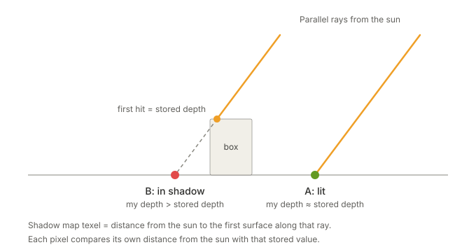

# Shadow mapping: a walkthrough of the Shadow Mapping Lab

Each step says what to try in the lab.

## The one idea

A point is **in shadow if something sits between it and the sun.** Shadow mapping checks that in two passes:

1. **From the sun:** render the scene's depth. For every direction the sun shines, store the distance to the *first* thing it hits. That image is the **shadow map**.
2. **From the camera:** for each pixel, work out its own distance from the sun and compare. If it's farther than what the map stored, something else got hit first, so the pixel is in shadow.



Everything else either sets up those two passes or fixes a problem they cause.

## Step 1: Put a camera on the sun (thumbnail 1, "Sun's view")

To render from the sun, you need view and projection matrices for it, like any camera.

- **View matrix:** place the sun's camera behind the area you care about, looking along the sun's direction.
- **Projection:** a directional light has parallel rays, so it uses an **orthographic** projection (a box), not a perspective one.

```js
const eye  = center + sunDir * (radius + 80);       // back up toward the sun
const view = lookAt(eye, center, up);
const proj = ortho(-radius, radius, -radius, radius, 0, 2 * radius + 90);
const lightVP = proj * view;                         // used in BOTH passes
```

The ortho box's width (`2 × radius`) decides how much ground the shadow map covers. Remember that for step 5.

*Try it:* move the **Sun azimuth/elevation** sliders and watch thumbnail 1. That's literally what the sun sees.

## Step 2: Render depth only (thumbnail 2, "Shadow map")

Render the scene with `lightVP` into a **depth texture** that has no color attachment, because you only want the depth buffer. The fragment shader does nothing.

```js
gl.bindFramebuffer(gl.FRAMEBUFFER, shadowFBO);       // depth attachment only
gl.framebufferTextureLayer(gl.FRAMEBUFFER, gl.DEPTH_ATTACHMENT, shadowTex, 0, layer);
gl.clear(gl.DEPTH_BUFFER_BIT);
for (const obj of scene) draw(obj, lightVP);         // vertex shader: lightVP * model * pos
```

In thumbnail 2, brighter means closer to the sun. Tall objects are bright blobs and the ground is a gradient. It's just a grayscale picture of depth.

## Step 3: Compare depths in the main pass (thumbnail 5, "Shadow mask")

Render normally from the camera. In the fragment shader, take the pixel's **world position**, push it through the **same `lightVP`**, and you get two things: where to look in the shadow map, and the pixel's own depth from the sun.

```glsl
vec4 lp = lightVP * vec4(worldPos, 1.0);
vec3 sc = lp.xyz * 0.5 + 0.5;            // NDC [-1,1] → texture space [0,1]
// sc.xy = where to read in the shadow map
// sc.z  = my own depth from the sun
float stored = texture(shadowMap, sc.xy).r;
float lit = (sc.z <= stored) ? 1.0 : 0.0;
```

`lit` multiplies **only the sun's contribution**. Ambient light still reaches shadowed areas, otherwise shadows would be pitch black. Surfaces facing away from the sun (N·L ≤ 0) are dark anyway, so they skip the lookup, which is why they show blue in the mask view.

*Try it:* open thumbnail **5**. White passed the depth test, black failed it.

## Step 4: Fix shadow acne (the bias controls)

Press **Show acne**. Ugly stripes appear on lit surfaces, especially the ramp and the ground.

**Why:** one shadow-map texel covers a patch of surface, but it stores **one** depth value. On a slanted patch, half the patch is a bit farther from the sun than the stored value, so it shadows *itself*. That gives alternating lit and shadowed stripes.

The fixes all push the comparison a little in favor of "lit":

- **Depth bias:** compare against `stored + bias`. Simple, but one value can't suit every surface.
- **Slope-scale bias:** `glPolygonOffset` adds more bias on slanted surfaces, where acne is worst.
- **Normal offset:** move the lookup point slightly along the surface normal before projecting it. It works very well and is measured in texels.
- **Draw back faces into the shadow map:** the stored depth becomes the *far* side of each object, so its front surface can't shadow itself.

**The trade-off:** press **Show peter-panning**. Too much bias detaches shadows from their objects. The table and spheres look like they float because the shadow starts too far from the contact point. Tuning means using the smallest bias that removes acne. **Balanced** is a reasonable setting.

## Step 5: Fight blocky edges with resolution and cascades (thumbnails 3 and 4)

Set **Resolution 256** and **Filter: Hard**. Shadow edges turn into staircases. Open thumbnail **4 (Texel grid)**: each cell is one shadow-map texel projected onto the scene. When a cell covers many screen pixels, you see blocks.

A single map can't be sharp everywhere. Covering 80 m at 2048² gives about 4 cm per texel, which is too coarse up close and wasted far away. **Cascaded shadow maps** fix this:

1. Split the camera's view distance into ranges. The **split** slider blends evenly spaced splits with logarithmic ones (log puts more detail close up).
2. For each range, fit its own ortho box around just that slice of the camera's view, and render a separate shadow map into one layer of a texture array.
3. In the main pass, each pixel picks its cascade by distance from the camera:

```glsl
int c = 0;
while (c < numCascades - 1 && viewDepth > split[c]) c++;
// then use lightVP[c] and layer c
```

*Try it:* thumbnail **3** colors each cascade, and the **Measured** table shows texel sizes. With the defaults, the nearest cascade is about 1 cm per texel and the farthest about 6 cm, all with the same memory per layer.

## Step 6: Stop shimmering (stabilization)

Turn off **Stabilize cascades**, turn on **Slowly orbit the camera**, and watch shadow edges crawl. Each frame, the ortho box is refit to the camera's view, so its size and position change slightly. The texel grid slides across the world, and edges re-quantize every frame.

The lab fixes it in two ways:

- **Bounding sphere:** fit a sphere around the frustum slice instead of a tight box. A sphere's size doesn't change when the camera rotates, so the texel size stays constant.
- **Texel snapping:** move the box only in whole-texel steps, so the grid stays locked to the world.

```js
const o = lightVP * [0,0,0,1];                    // where the world origin lands
const t = o.xy * (size / 2);                      // ...in texel units
proj.translate((round(t) - t) / (size / 2));      // nudge onto the texel grid
```

## Step 7: Soften edges with filtering

Real sun shadows have soft edges, called the penumbra. Step through the **Filter** menu:

1. **Hard:** one compare, 0 or 1, so you see texel staircases.
2. **Hardware PCF:** a `sampler2DShadow` with LINEAR filtering makes the GPU do 4 compares and blend the 0/1 results in one call. It's free, and it's why the lab binds the shadow map twice with two different sampler objects.
3. **PCF N×N:** average many hardware lookups in a grid. The key rule is **compare first, then average**. Averaging depths and then comparing is wrong, because a mix of a near and a far depth is a depth that doesn't exist.
4. **Poisson:** 16 taps in a scattered pattern, rotated randomly per pixel. You get grainy noise instead of banding, for fewer taps.
5. **PCSS:**
   - search nearby texels for blockers and average their depth,
   - estimate the penumbra width as (my depth − blocker depth) × sun size,
   - run PCF with that radius.

   Shadows stay sharp where objects touch the ground and blur further away. Raise **Sun size** and look at the table legs.

## The whole pipeline, in one breath

**For each cascade:** fit an ortho box from the sun → render depth into one layer.
**For each camera pixel:** pick a cascade → project into the sun's space → compare depths (with bias, and filtered) → multiply the sun's light by the result.

Every control in the lab changes one link in that chain.
