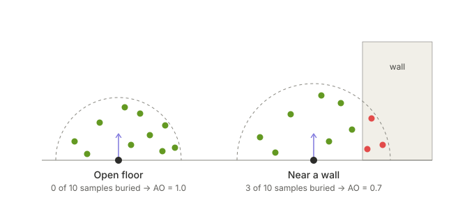

# SSAO: a walkthrough of the SSAO Lab

Each step says what to look at in the lab.

## The one idea

Ambient light is light from the whole sky. A point out on an open floor sees the entire sky above it. A point in a corner, under a table or between two boxes sees only part of it, so it should receive less ambient light. **Ambient occlusion (AO)** is the fraction of that sky a point *can* see within a short radius: 1.0 = fully open, 0.0 = completely enclosed.

Real AO would trace rays in 3D. **Screen-space AO** cheats: it only looks at what's already on screen (the depth buffer) and asks, for a few sample points around each pixel, "is this point buried inside something?"



That's the whole technique: scatter samples around each pixel, count how many are buried, and darken the ambient light by that fraction.

## Step 1: The G-buffer (thumbnails 1 and 2)

SSAO runs after the geometry pass and needs two things per pixel:

- **Linear depth:** the distance from the camera along the view axis. It's stored in a single R32F channel, 4 bytes.
- **The view-space normal:** which way the surface faces. It's packed into RGBA8 as `n * 0.5 + 0.5`.

You don't need a position texture. A pixel's 3D position can be **rebuilt** from its depth and its screen position, because the camera's field of view tells you how wide the view is at any depth:

```glsl
// tanHalf = (tan(fov/2) * aspect, tan(fov/2))
vec3 posAt(vec2 uv) {
  float z = texture(depth, uv).r;
  return vec3((uv * 2.0 - 1.0) * tanHalf * z, -z);   // view-space position
}
```

This is also the biggest performance win. Each pixel reads depth up to 64 times, so going from a 16-byte position to a 4-byte depth cuts memory traffic by 4×.

## Step 2: The sample kernel (the small diagram in the panel)

The kernel is a fixed set of 3D offsets you place around each pixel. It's generated once on the CPU:

```js
for (let i = 0; i < n; i++) {
  let p = randomPointInHemisphere();           // z ≥ 0 means "above the surface"
  let s = i / n;
  p *= lerp(0.1, 1.0, s * s);                  // pack more samples close to the center
}
```

Two design choices:

- **Hemisphere, not sphere.** Pick **Crytek** in the lab. Its samples fill a whole sphere, so on a flat floor half of them are underground and always count as buried. Flat surfaces come out about 50% gray, which was the famous look of early SSAO (Crysis, 2007). Orienting the samples in a hemisphere along the normal fixes that.
- **Denser near the center.** Close occluders block more of the sky than distant ones, so they should count more.

## Step 3: The test (thumbnail 4, "AO raw")

For each pixel, and for each sample:

1. **Orient the kernel** to the surface by building a rotation (a TBN matrix) from the normal.
2. **Place the sample** at `p + TBN * kernel[i] * radius`.
3. **Project it** to the screen to find which pixel it lands on.
4. **Read the depth there.** If the stored surface is *closer to the camera* than the sample, the sample is behind something, so it's buried.

```glsl
vec3 s = p + TBN * kernel[i] * radius;
vec4 c = proj * vec4(s, 1.0);
vec2 suv = c.xy / c.w * 0.5 + 0.5;            // where on screen?
float sceneZ = -texture(depth, suv).r;         // what's actually there?
float rangeCheck = smoothstep(0.0, 1.0, radius / abs(p.z - sceneZ));
occlusion += (sceneZ >= s.z + bias ? 1.0 : 0.0) * rangeCheck;
...
ao = 1.0 - occlusion / float(n);
```

Two of those terms fix specific artifacts:

- **Bias** stops a surface from occluding itself because of depth precision. Set Bias to 0 and flat areas get blotchy. It's the same problem as shadow acne.
- **Range check:** turn it off in the lab and look at the edges of the table and blocks against the far wall. Dark **halos** appear. A sample next to the table's edge "lands" on the table, which is a meter in front, and counts as buried even though the table is far away. The range check fades out occluders that are much farther than the radius.

## Step 4: Random rotation (thumbnail 3, "Noise")

With only 16 samples, every pixel uses the *same* pattern, so you get smooth but **banded** rings. Turn off **Random rotation** to see them.

The fix is to rotate the kernel differently for each pixel, using a tiny **4×4 texture of random rotation vectors** tiled across the screen:

```glsl
vec3 rv = texelFetch(noise, ivec2(gl_FragCoord.xy) & 3, 0).xyz;
vec3 T = normalize(rv - n * dot(rv, n));     // random tangent in the surface plane
mat3 TBN = mat3(T, cross(n, T), n);
```

Neighboring pixels now sample in 16 different directions. Banding turns into **fine noise**, which is easy to blur away. Look at thumbnail 4 with Blur set to *None*: you can see the 4×4 pattern.

### What the noise tile is for

It turns **banding into noise**, and noise is easy to blur away.

**The problem it solves.** With only 16 samples, you test 16 fixed directions around each pixel. That's a coarse approximation, so every pixel's answer has some error. Without the noise tile, every pixel uses **the same 16 directions**, so neighboring pixels make **the same error**. Errors that line up across the screen form visible structure: rings and bands that follow the geometry.

**What the tile does.** Each pixel picks one of 16 random rotations based on its position (`gl_FragCoord.xy & 3`) and rotates the whole kernel by it before sampling. Now neighboring pixels test **different** directions:

- The total error is about the same, but it's **scattered** from pixel to pixel instead of lined up. Your eye reads that as fine grain, not shapes.
- Any 4×4 block of pixels together has tested 16 rotations × 16 samples = **256 different directions**, even though each pixel only paid for 16.

**Why the blur goes with it.** The blur collects that spread-out information. A **4×4 box blur** averages exactly one copy of the tile, so every pixel's result combines all 16 rotations. The grain disappears and you end up with something close to the 256-direction answer, without visible structure.

**Why a small repeating tile instead of fully random noise per pixel?**

- **It's matched to the blur.** Because the pattern repeats exactly every 4 pixels, a 4×4 average always covers all 16 rotations. With fully random noise there's no such guarantee, so you'd need a bigger, more expensive blur.
- **It's cheap.** 16 texels stay in the texture cache, so the lookup costs almost nothing.
- **It's stable.** The same pixel gets the same rotation every frame, so the result doesn't flicker.

The trade-off is that 4×4 only gives 16 rotations. A bigger tile gives more variety but needs a bigger blur, and a smaller one doesn't break up the banding enough. 4×4 is the classic balance.

**What modern engines do instead.** They usually use **blue noise** or **interleaved gradient noise** (random values spread out evenly, with no clumps), and **change it every frame**. TAA then averages the results over time, so 16 samples per frame add up to hundreds over a few frames. Same idea, done across time instead of across neighboring pixels.

## Step 5: Blur (thumbnail 5, "AO blurred")

- **4×4 box blur:** average exactly the 4×4 block that the noise tile repeats over. All 16 rotations are averaged together, so the pattern disappears, and it's very cheap.
- **Bilateral blur:** a Gaussian blur that **lowers the weight of neighbors at a different depth**. AO doesn't bleed across object edges, such as from the table onto the wall behind it. It runs as two passes (horizontal and vertical) to stay cheap.

```glsl
float w = gaussian(i) * exp(-abs(zNeighbor - zCenter) / (0.03 * zCenter + 0.02));
```

In a real engine, TAA often does most of this denoising for free across frames, so the blur can be lighter.

## Step 6: Apply it to the ambient term only (thumbnails 6 and 7)

```glsl
color = albedo * (ambient * ao + sunLight);
```

AO multiplies **only the ambient/sky light**. The sun is direct light, and its shadow map already handles what blocks it. Darkening it again would make shadowed areas too dark and corners muddy.

Move **Split compare** to 50%: the left half is without AO, the right half with it. Without AO, objects look like they float. With it, they sit on the floor.

## Step 7: Better estimators (techniques 3 and 4)

The hemisphere test only asks a yes/no question per sample. Later techniques measure *how much* each neighbor blocks:

- **SAO / Alchemy (2011–12):** sample a spiral of neighbors **in screen space**, rebuild each one's 3D position, and add up `max(0, v·n − bias) / |v|²`. A neighbor that's close (small |v|) and high above the surface (large v·n) blocks a lot of sky. Neighbors fade out smoothly at the radius. Smooth result for few samples, with no projection math per sample.
- **HBAO (2008):** march a few **rays across the screen** from the pixel. Along each ray, track the highest **horizon** angle any neighbor reaches above the surface. Higher horizon means less sky. This is closer to the real definition of AO, and it's the ancestor of GTAO, which most current engines use.

## Step 8: Performance

The cost is roughly **samples × AO pixels**, and the panel shows it as "depth reads per frame." Three levers, from biggest to smallest:

1. **Resolution:** half-res AO is ¼ of the pixels. AO is soft and low-frequency, so the loss is hard to see. That's why engines do it.
2. **Bytes per read:** depth only (4 B) instead of positions (16 B).
3. **Sample count:** 8–16 with noise and blur usually beats 64 without.

## Limits of doing it in screen space

The depth buffer only knows the **front surface** of what's visible, which causes three known problems:

- **Off-screen objects can't occlude.** Pan the camera until the blocks touch the screen edge: their AO on the floor fades.
- **Everything is assumed infinitely thick.** A thin pole occludes as if it were a solid wall behind it.
- **Hidden geometry is unknown.** Whatever is behind the front object doesn't count.

That's why engines with ray tracing replace SSAO with **RTAO**: ray-traced AO, which works in the full 3D scene.

## The whole pipeline, in one breath

**G-buffer** (depth + normal) → **per pixel:** rebuild the position, rotate the kernel by noise, test each sample against depth (with bias and range check) → **blur** the noise away → **multiply the ambient light** by the result.
