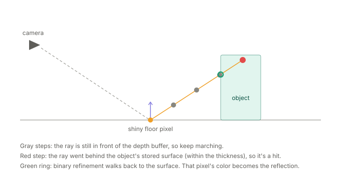

# Screen-space reflections: a walkthrough of the SSR Lab

Each step says what to look at in the lab.

## The one idea

A reflection is what you'd see if you stood on the shiny surface and looked in the mirror direction. The "proper" way is to render the scene a second time from that mirrored viewpoint, which is expensive and only works for flat mirrors.

**Screen-space reflections** cheat: the scene is *already rendered*. So for each shiny pixel, you shoot the reflected ray **through the depth buffer**, find the first place it goes behind something visible, and **copy that pixel's color** as the reflection.



Everything in the lab is one of three things: building that ray, marching it efficiently, or hiding the cases where the screen doesn't have the answer.

## Step 1: G-buffer and lighting (thumbnails 1–3)

SSR runs after the scene is lit and needs four things per pixel:

- **depth**, to rebuild the 3D position and to test the ray against,
- **the normal**, to compute the mirror direction,
- **material**: reflectivity and roughness. Pixels with zero reflectivity skip the trace entirely, which is why they look dark gray in the debug views.
- **the lit color**, thumbnail 3. This is what reflections copy from.

In a real engine the color source is usually **last frame's final image**, reprojected. That way reflections include other reflections, transparency and so on. The lab uses this frame's lit image to keep things simple.

## Step 2: Build the reflected ray

```glsl
vec3 P = posFromDepth(uv);          // view-space position (camera at origin)
vec3 V = normalize(P);              // from the camera to the pixel
vec3 R = reflect(V, N);             // mirror it around the normal
P += N * 0.01;                      // nudge off the surface so it doesn't hit itself
```

## Step 3: March and test (method 1, the view-space march)

Walk along `P + R·t` in fixed 3D steps. At each step, project the point to the screen, read the depth buffer there, and compare:

```glsl
vec3 Q = P + R * t;
vec2 q = project(Q);                 // where on screen?
float rayDepth   = -Q.z;             // how far the ray is from the camera
float sceneDepth = depth(q);         // how far the visible surface is
if (rayDepth > sceneDepth && rayDepth < sceneDepth + thickness) → hit
```

"The ray went behind the visible surface" is the screen-space way of saying "the ray hit something."

*Try it:* pick **View-space linear march** and set **Step length** to 1 m. Reflections turn blocky, and thin things like the pole get skipped. Near the camera one step jumps over many pixels, while far away many steps land on the same pixel and waste work.

## Step 4: March in screen space instead (method 2, the DDA)

McGuire & Mara's fix is to project the ray's **start and end** to the screen once, then walk the **2D line between them pixel by pixel**, or every *Stride* pixels.

```glsl
// Linear in screen space: position, z/w and 1/w
for (s = jitter; s < numPixels; s += stride) {
  vec2 pixel = S0 + dS * s;
  float rayDepth = -(z0k + dzk * s) / (k0 + dk * s);   // perspective-correct depth
  ...same test as before...
}
```

The trick is that depth is **not** linear across the screen, but `z/w` and `1/w` are. So you interpolate those two and divide, the same way the GPU interpolates texture coordinates. Every step lands on a new pixel, so no pixel is skipped and none is tested twice.

Engines go one step further with **Hi-Z**: a mip pyramid of the depth buffer where each texel stores the closest depth of its block. A ray can then skip large empty areas in one jump, refining down to single pixels only near surfaces.

## Step 5: Binary refinement

A hit is only known to lie somewhere *between the last two steps*. Without refinement, every reflection snaps to the step grid and you get **stair-stepped edges**. Binary search halves that interval a few times:

```glsl
for (k = 0; k < refineSteps; k++) {
  m = (a + b) / 2;
  if (behindSurface(m)) b = m; else a = m;
}
hit = b;
```

*Try it:* set **Binary refine** to 0, then 4. Four extra reads make edges much cleaner.

## Step 6: Thickness

The depth buffer only stores each object's **front surface**. It has no idea how deep things are behind it. When a ray goes "behind" a surface, SSR has to guess whether it hit the object or passed behind it. **Thickness** is that guess: "assume every object is this deep."

- **Too thick** (try 3 m): rays that should pass behind the spheres and the pole count as hits, so reflections **smear** behind objects.
- **Too thin** (try 0.02 m): rays slip between steps and miss, leaving **holes and gaps**.

## Step 7: Hit UV and confidence (thumbnails 4 and 6)

The trace writes four numbers per pixel: **(hit u, hit v, confidence, steps)**.

- **Hit UV** (thumbnail 4): red = the hit's screen x, green = its screen y, black = no hit. It's the standard SSR debug view.
- **Confidence** (thumbnail 6) is where SSR hides its blind spots. It's 1 for a good hit, multiplied down by three fades:
  - **Screen edge:** near the edge, the ray is about to need pixels that don't exist. Fade it out instead of cutting it off.
  - **Rays pointing back toward the camera:** what's behind you was never rendered, so there's nothing to reflect. Look steeply down at the floor and reflections disappear.
  - **Max distance:** fades out very long rays.

When confidence drops, the lab blends toward a **fallback**, the sky here. Real engines use **reflection probes** (pre-rendered cubemaps) or ray tracing for this. That's why SSR is never used alone.

## Step 8: Combine (thumbnails 7 and 8)

```glsl
float F = F0 + (1.0 - F0) * pow(1.0 - dot(N, -V), 5.0);    // Fresnel (Schlick)
float lod = log2(roughness * travelPixels * 0.6);           // glossy blur
vec3 hitColor = textureLod(litImage, hitUV, lod).rgb;
vec3 reflection = mix(skyFallback, hitColor, confidence);
vec3 final = mix(lit, reflection, F);
```

- **Fresnel:** surfaces reflect more at grazing angles. The floor far away is mirror-like, while the floor near your feet is mostly its own color.
- **Glossy reflections:** a rough surface spreads the reflection into a cone, and the cone gets wider the farther the ray travels. The cheap approximation is to read from a **blurrier mip** of the lit image, chosen by roughness × travel distance. Raise floor **Roughness** to see it.

## Step 9: Cost (thumbnail 5)

The steps heatmap shows that **misses are the most expensive rays**: they run all the steps and find nothing. Hits on nearby objects stop early. The levers:

- **Jitter:** start each ray at a slightly different offset in a 4×4 pattern. Banding turns into noise, the same trick as the SSAO noise tile, which TAA or a blur then cleans up.
- **Half resolution:** ¼ of the rays.
- **Stride and Hi-Z:** fewer, bigger steps across empty space.
- **Skipping non-reflective pixels:** free, and usually most of the screen.

## The limits

SSR can only reflect **what is already on screen**. Anything off-screen, behind the camera, or hidden behind another object can't appear in a reflection. That's why games combine it with reflection probes, and why ray-traced reflections replaced it in high-end engines.

## Use the probe

Click anywhere on the floor:

- The **yellow dot** is the pixel you clicked.
- The **dashed line** is its ray's path *on screen*.
- The **cyan ring** is the pixel whose color it borrows.

The HUD reports hit or miss, the step count and the confidence. Try clicking near the screen edge, near the pole, and on the floor right in front of the camera.

## The whole pipeline, in one breath

**Lit image + G-buffer** → **per shiny pixel:** reflect the view ray, march it across the screen (with stride, jitter and refinement), stop where it goes behind a surface (within the thickness) → **fade** what the screen can't know, **fall back** to the sky or probes → **blend** with Fresnel, blurred by roughness.
