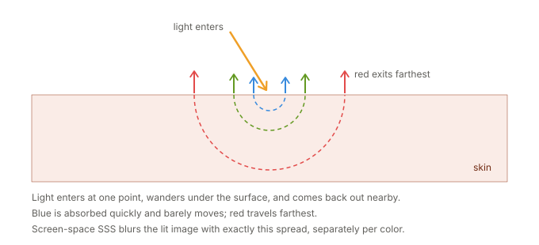

# Subsurface scattering: a walkthrough of the SSS Lab

Each step says what to look at in the lab.

## The one idea

Skin, wax, jade and milk aren't opaque surfaces. Light **enters** them, bounces around underneath, and **comes out somewhere else**, usually within a few millimeters. How far it travels depends on the color, because skin absorbs blue and green quickly but lets red travel deep.



The curve "how much light exits at distance *r* from where it entered" is the material's **diffusion profile**. Screen-space SSS turns it into a blur: light that landed on one pixel gets spread to its neighbors, by a real-world distance, with a wider spread for red. Every control in the lab changes how that blur is done.

## Why the objects are striped

The stripes come from the **Striped key light** option under Lighting, which is on by default. It works like a projector shining through window blinds: the main light alternates between bright and dark bands across the objects.

SSS is hard to see under smooth lighting. Its effect is that light entering in one spot comes out a little further away, so every boundary between a lit and a dark band is a test edge where light should leak into the dark side.

- Move **Split compare** to 50% and zoom in on a stripe edge on the head. Left (no SSS): knife-sharp edges. Right (SSS): soft edges, with a **reddish glow** inside the dark bands, because red travels farthest under skin.
- **Wax** blurs the edges widely and warmly, and **jade** spreads mostly green.
- Uncheck **Striped key light** for a normal smooth key light. Then you mostly see SSS softening the skin bumps and the edge where the lit side turns dark.

## Step 1: The G-buffer and SSS mask (thumbnails 1–3)

The geometry pass writes the usual depth and normals, plus two values per pixel:

- **SSS strength:** how much this pixel scatters. Skin, wax and jade are 1, the floor is 0.
- **Material ID:** which profile to use (skin, wax or jade).

Thumbnail 3 shows this mask. Only colored pixels get blurred, and everything else is left alone. Real engines mark these pixels in the **stencil buffer** so the blur passes skip everything else for free.

## Step 2: Split the lighting into diffuse and specular (thumbnails 4 and 7)

The lighting pass writes **two** buffers instead of one:

- **Diffuse light** (irradiance): the light that *entered* the surface. This is what scatters.
- **Specular light:** the light that *bounced off the very top layer* (the oily film on skin). It never went inside, so it must **not** be blurred.

```glsl
oDiffuse  = keyLight * NdotL + ambient + transmission;   // no albedo yet
oSpecular = keyLight * pow(NdotH, gloss) * specStrength;
...
final = albedo * blur(diffuse) + specular;
```

The albedo is applied **after** the blur ("post-scatter texturing"). The color texture's detail, like freckles or pores, stays sharp, and only the *lighting* gets soft.

*Try it:* uncheck **Keep specular out of the blur**. Highlights turn into dull smudges, and skin looks like satin instead of something wet and alive.

## Step 3: From profile to kernel (the plot in the panel)

The lab uses two well-known profiles:

- **Skin:** d'Eon & Luebke's **sum of 6 Gaussians**, measured from real skin. Each Gaussian has an R, G and B weight. The wide ones are almost pure red, which is why red reaches farthest.
- **Wax and jade:** **Burley's normalized diffusion**, which Disney and Unreal use. One curve shape with a scatter distance per channel, which is easy to tune for any material.

To turn the profile into a blur kernel, the lab picks N tap positions (9, 17 or 25), packed densely near the center, and weights each one per channel:

```js
for (i = 0; i < N; i++) {
  t = -1 + 2 * i / (N - 1);
  offset[i] = range * sign(t) * t * t;                  // dense near 0, sparse at the tails
  weight[i] = profile(|offset[i]|) * areaAroundTap(i);  // one value each for R, G, B
}
normalize each channel so its weights sum to 1;         // the blur moves energy, never adds it
```

The plot shows those weights. The red curve stays high far from the center, while blue drops to almost nothing within a millimeter.

## Step 4: Two 1D passes instead of one 2D blur (thumbnails 5 and 6)

A full 2D blur with 25 taps per side would be 25 × 25 = **625** reads per pixel. Separable SSS blurs **horizontally** (thumbnail 5), then blurs that result **vertically** (thumbnail 6): 25 + 25 = **50** reads.

A circular profile isn't perfectly separable, so the result is an approximation, but it's very close for these soft, bell-shaped curves. That's the main idea behind Jimenez's 2015 technique, and why it shipped in many games.

## Step 5: Width in millimeters, not pixels

The profile is in **mm**, and the screen is in **pixels**. Each tap's offset is converted using the pixel's depth:

```glsl
float pxPerMm = width * mmToWorld * projScale / depth;   // farther away = fewer pixels per mm
vec2 tapUV = (fragCoord + direction * offsetMm * pxPerMm) / screenSize;
```

*Try it:* switch to **Naive screen blur** and zoom in and out. A fixed 12-pixel blur makes the face look like melted wax from far away and barely changes it up close. With **Scale width by depth**, the scattering stays the same physical size at any distance, the way real skin does.

## Step 6: Follow the surface (depth-aware)

Blurring in screen space means neighboring pixels are often *different objects*: the head's edge next to the background, or the nose in front of a cheek. Light can't scatter through air, so each tap checks:

```glsl
float zs = depth(tapUV);
float f = clamp(abs(zs - zCenter) / kernelWorldSize, 0.0, 1.0);
if (!isSSS(tapUV)) f = 1.0;
tapColor = mix(tapColor, centerColor, f);    // wrong surface → pretend it's the center
```

*Try it:* turn off **Follow the surface** and look where the head meets the dark background. Light leaks out as a dim halo, and dark background leaks in around the silhouette.

## Step 7: Per-channel weights

With **Per-channel profile** on, R, G and B each use their own weights. Turn it off and all three share an average curve: the blur is the same width for every color, so the result looks like soft gray plastic. The **red fringe** inside shadow edges is the visual cue your brain reads as "skin." On the striped head it shows up as a warm glow creeping into each dark band.

## Step 8: Transmission (the back light)

Thin parts like ears, nostrils and fingers let light **pass all the way through**. The lab uses a cheap, widely used approximation (Barré-Brisebois & Bouchard, GDC 2011):

```glsl
vec3 H = normalize(backLightDir + N * distortion);
float through = pow(saturate(dot(V, -H)), power) * scale;   // bright when looking into the light
diffuse += tint * through * exp(-thickness * k);            // thin parts let more through
```

Thickness here is a constant per part: ears are thin, the head is thick. Jimenez's full version estimates thickness per pixel from the **shadow map** (how far the light traveled inside the object). Press **Close-up on the ear** to see the red glow. Transmission is added to the diffuse buffer *before* the blur, so it gets scattered too.

## Step 9: Cost

**Taps per SSS pixel = 2 × taps per pass**, which is 50 at the default. Engines keep this cheap by:

- running the blur **only on SSS pixels**, using the stencil mask,
- using **fewer taps** for distant characters (9–17 is often enough),
- in newer engines, **importance sampling** the profile with a few random taps per frame and letting TAA average them, which is how Unreal's Burley SSS works.

## The limits

- **It only knows what's on screen.** Light can't scatter in from a part of the face that's hidden or off-screen.
- **Separable blur is an approximation.** At very large widths you can see faint "+" shaped artifacts.
- **Thickness is a guess.** Real transmission depends on actual geometry, which is why film renderers trace random walks inside the mesh instead.

## The whole pipeline, in one breath

**G-buffer + SSS mask** → **lighting split** into diffuse (enters the skin) and specular (bounces off) → **blur the diffuse twice** (horizontal, vertical) with the material's per-color profile, scaled to millimeters by depth and stopped at depth edges → **final = albedo × blurred diffuse + specular**.
