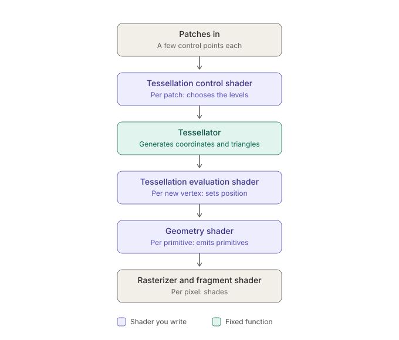

# Tessellation and geometry shaders: a tutorial

Try each step in the lab as you read.



**A note on the lab.** Browsers have no tessellation or geometry shader stages: WebGL 2 and WebGPU both leave them out. The lab runs the same steps by other means (see "How the lab does this without those stages"). The GLSL in its code box is OpenGL 4.1 reference code. It was written for reading and has not been compiled.

## The idea

You send the GPU a small number of patches, and it produces the triangles. Three things happen in order: you say how finely to cut each patch, fixed hardware does the cutting, and you say where each new vertex goes. The geometry shader comes after that and works on finished triangles, one at a time.

## Step 1: Patches

A patch is a list of control points with no built-in meaning. You choose the count and draw with a patch primitive:

```c
glPatchParameteri(GL_PATCH_VERTICES, 16);
glDrawArrays(GL_PATCHES, 0, 4 * 16);
```

The lab has three kinds: 4 corners (terrain), 16 Bézier control points, and 3 corners (icosahedron). Stage 1 in the strip shows them.

## Step 2: The control shader chooses levels

The control shader (TCS) sees all control points of one patch and writes two sets of numbers:

- **Outer levels:** how many pieces each border is cut into. A quad has four, a triangle has three.
- **Inner levels:** how finely the middle is cut. A quad has two (along u and along v), a triangle has one.

They are separate so that a border can match the neighboring patch while the middle does something else. An outer level of 0 or less discards the whole patch, which is a cheap way to cull.

Which outer level belongs to which border:

| Domain | `gl_TessLevelOuter[0]` | `[1]` | `[2]` | `[3]` |
|---|---|---|---|---|
| Quad | the u = 0 edge | the v = 0 edge | the u = 1 edge | the v = 1 edge |
| Triangle | the edge opposite vertex 0 | opposite vertex 1 | opposite vertex 2 | unused |

For a quad, `gl_TessLevelInner[0]` cuts along u and `[1]` cuts along v.

The lab's distance modes use this rule for one edge:

```glsl
float edgeLevel(vec3 a, vec3 b) {
  float onScreen = distance(a, b) * projScale / distance(eye, 0.5 * (a + b));
  return clamp(onScreen / targetPx, 1.0, maxLevel);
}
```

`projScale` is `viewportHeight / (2 * tan(fov / 2))`, so `onScreen` is roughly the edge's length in pixels. Dividing by the target edge length gives the number of pieces.

### Why cracks appear

If two neighbors cut their shared border into different numbers of pieces, the vertices on the two sides do not line up. Displacement then pulls them apart and you see holes. The fix has two parts:

1. Compute each outer level only from that edge's two endpoints, so both patches get the same number.
2. Displace by something both sides agree on. The lab samples height by world position, not by patch-local coordinates.

In the lab, "one level per patch" breaks the first rule, and the pink background shows through the cracks.

## Step 3: The tessellator

This stage is fixed hardware. It knows nothing about your surface. It works in the patch's own coordinates, (u, v) in a unit square or barycentric (a, b, c) in a triangle, and outputs coordinates plus the triangles that connect them.

**Cutting one edge** (`subdiv` in the lab):

| Spacing | Rule | What you see |
|---|---|---|
| `equal_spacing` | Round the level up to a whole number n; n equal pieces | Triangles pop in at whole numbers |
| `fractional_even_spacing` | Round up to an even n; n − 2 equal pieces plus two shorter ones | New vertices slide in smoothly |
| `fractional_odd_spacing` | The same with an odd n | Same, and level 1 stays one piece |

**Cutting a quad** (`quadPattern`):

1. Cut u and v by the two inner levels. Everything except the outermost ring is a regular grid.
2. Cut each border by its own outer level.
3. Fill the ring between border and grid. `stitch` walks along both rows and always advances the side whose next point comes first.

With every level equal to n, a quad becomes 2n² triangles, so level 4 gives 32.

**Cutting a triangle** (`triPattern`): concentric triangles, each with two fewer pieces per side than the one outside it, ending in a point or a single triangle. Level 3 gives 13 triangles and level 4 gives 24.

The small diagram in the lab's panel draws this pattern for the patch nearest the camera.

## Step 4: The evaluation shader places vertices

The evaluation shader (TES) runs once per generated vertex. It reads `gl_TessCoord` and all control points of the patch, and returns a position. This is where the surface is defined. The lab's three versions:

```glsl
// Terrain: bilinear blend of 4 corners, then displacement
vec3 p = mix(mix(P0, P1, t.x), mix(P3, P2, t.x), t.y);
p.y += height(p.xz) * amount;

// Bézier: weight 16 control points with Bernstein polynomials
p += bu[i] * bv[j] * P[j * 4 + i];

// Icosahedron: barycentric blend, then push onto a sphere
vec3 p = b.x * P0 + b.y * P1 + b.z * P2;
p = mix(p, normalize(p) * radius, roundness);
```

For normals, the lab evaluates the surface at two nearby tess coordinates and takes the cross product of the differences.

## Step 5: The geometry shader

The geometry shader (GS) runs once per primitive and sees all of its vertices. It declares an input type, an output type and a maximum vertex count, then calls `EmitVertex()` and `EndPrimitive()` as many times as it likes, including zero.

That gives it three abilities a vertex shader lacks, and the lab has one mode for each:

- **Per-face data (Explode):** the face normal and centroid need all three vertices.
- **Changing the primitive type (Normals):** triangles go in, line strips come out.
- **Amplification (Grass):** each triangle is emitted, plus one extra blade on its centroid. This is why the blade count follows the tessellation level.

The wireframe overlay also depends on per-primitive knowledge: each corner gets a different barycentric coordinate, and the fragment shader draws a line where one of them is near zero.

## How the lab does this without those stages

- **Control shader:** `retessellate()` in JavaScript computes the levels for every patch.
- **Tessellator:** `getPattern()` returns the triangle list for those levels, in patch coordinates.
- **Evaluation shader:** the function `tes()` inside the vertex shader. Control points live in a float texture, one row per patch (texels 0 to 15 are control points, 16 holds the inner levels, 17 the outer levels).
- **Geometry shader:** each tessellated triangle is one instance, and its three tess coordinates are instance attributes. `gl_VertexID` picks the corner. Because the vertex shader has all three coordinates, it can evaluate all three corners and so compute a face normal or centroid. Lines and blades are extra instanced draws over the same buffer.

One caveat: OpenGL leaves the exact length and position of the two short pieces in the fractional modes to the implementation, so a real GPU's pattern can differ from the lab's. The lab's pattern was checked for full coverage and consistent winding, but it was not compared against a real GPU's output.

## Cost, and what is used today

- Tessellation is still common for terrain, water and displacement, because detail follows the camera and the mesh on disk stays small.
- Geometry shaders are usually slow when they amplify, since output size is not known in advance. Metal has none at all. Instancing or compute shaders now do most of that work.
- Mesh shaders (DirectX 12, Vulkan) replace both stages with one programmable stage that outputs small batches of triangles directly.

## Things to try in the lab

1. Click through the stages under the scene, 1 to 5.
2. Pick **Manual**, set **Outer** to 1 and drag **Inner**. Then do the reverse.
3. With `equal_spacing`, drag a level slowly and watch triangles pop. Switch to a fractional mode and watch vertices slide.
4. On the terrain, switch between **per edge** and **per patch** and look along patch borders.
5. Orbit with a distance mode on and watch the **Tessellation levels** stage.
6. On the Bézier scene, set both levels to 1, then raise them.
7. Pick **Grass** and change the levels: the blade count follows the triangle count.

---

# The evaluation shader in more detail

The evaluation shader is the vertex shader of the tessellated mesh. The tessellator has produced a vertex that exists only as a coordinate inside the patch, and the TES turns that coordinate into a real position and real attributes.

## What it receives

- **`gl_TessCoord`:** where this vertex sits inside the patch.
  - Quads: `xy` is (u, v), each from 0 to 1.
  - Triangles: `xyz` is barycentric, and the three values sum to 1.
  - Isolines: `x` runs along the line, `y` selects which line.
- **`gl_in[]`:** every control point of the patch, exactly as the control shader wrote them. Your own per-control-point outputs arrive as arrays too, for example `in vec3 normal[]`.
- **`patch in` variables:** values the control shader wrote once per patch, such as a material ID.
- **The levels:** `gl_TessLevelOuter` and `gl_TessLevelInner` are readable here.

The layout line at the top also configures the tessellator, even though it is written in this shader:

```glsl
layout(quads, fractional_even_spacing, ccw) in;
```

## What it must do

Nothing is interpolated for you. The tessellator gives a coordinate and no data, so every attribute a later stage needs has to be computed by hand: position, normal, UV, color.

```glsl
vec3 b = gl_TessCoord;
vec3 pos = b.x * gl_in[0].gl_Position.xyz + b.y * gl_in[1].gl_Position.xyz + b.z * gl_in[2].gl_Position.xyz;
vec2 uv  = b.x * uvIn[0] + b.y * uvIn[1] + b.z * uvIn[2];
vec3 n   = normalize(b.x * normalIn[0] + b.y * normalIn[1] + b.z * normalIn[2]);
```

If there is no geometry shader, the TES must also write `gl_Position` in clip space. If there is one, the TES can pass a world-space position and let the geometry shader project it, which is what the lab's reference code does.

## What "evaluate" means

The interpolation rule you choose defines the surface. The same grid of coordinates gives very different shapes:

- **Linear blend:** the patch stays flat, so you only gain vertices. This is useful only when followed by displacement.
- **Displacement:** blend linearly, then move the vertex along its normal by a height-map value. This is the terrain scene.
- **Bézier or other spline:** treat the control points as a control net and compute the curved surface. This is the Bézier scene.
- **Curving from normals:** PN triangles and Phong tessellation bend a flat triangle using its vertex normals, so an ordinary low-poly mesh gets a smooth silhouette.
- **Projection:** push the vertex onto an analytic shape, as the icosahedron scene does with `normalize(p) * radius`.

In the lab all of this is the function `tes()` inside the vertex shader. The Displacement and Roundness sliders change only that function, which is why the triangle count does not move when you drag them.

## Details that matter in practice

- **Normals change with the position.** After displacement the interpolated normal is wrong. Recompute it from the height map with finite differences, or analytically from the spline's derivatives, or leave it to a normal map in the fragment shader.
- **Texture lookups need an explicit mip level.** Only fragment shaders have automatic derivatives, so `texture()` here reads the base level. Use `textureLod()` and choose the level from the tessellation density, otherwise the height map aliases when the mesh is coarse. The lab's reference terrain code uses plain `texture()` for brevity.
- **Shared borders must evaluate identically.** A vertex on a border is computed twice, once by each patch. If the two results differ even slightly, a crack opens. Displace by something both patches agree on (the lab uses world position), and mark the calculation `precise` so the compiler does not reorder the arithmetic differently in each case.
- **Cost follows vertices, not triangles.** A quad at level n has about (n + 1)² vertices and 2n² triangles, so the TES runs roughly half as many times as there are triangles. Keep it cheap anyway, because at level 64 that is still over 4,000 runs per patch.
